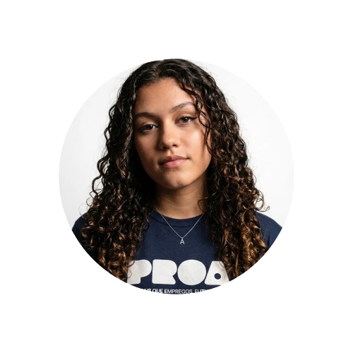
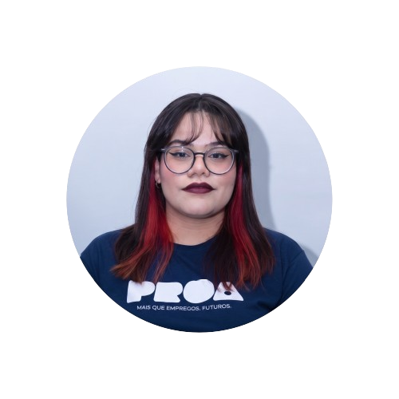
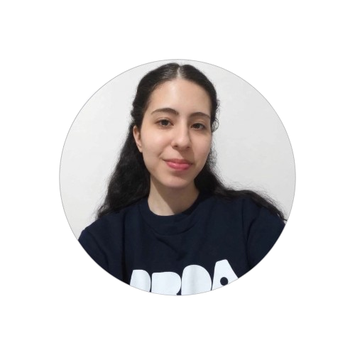
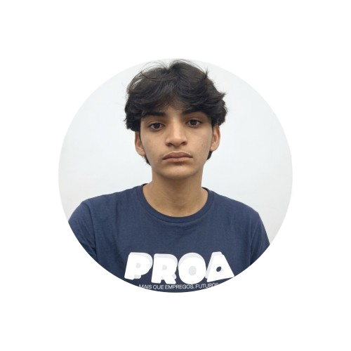
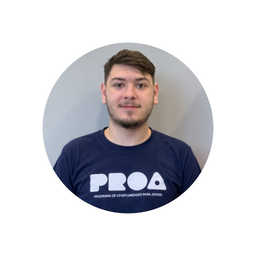

# SKANE

> A bomba não diz, mas o seu carro sente.

Projeto desenvolvido pelo grupo **SKANE** - **Equipe 4** no **PROA Profissão**, apresentado no Demoday.  

## O problema

Nas pesquisas que fizemos sobre veículos e combustível, as dores mais frequentes dos motoristas foram:

- **Desconfiança** na hora de abastecer: o que foi pago chegou mesmo ao tanque?
- **Problemas financeiros** causados por gastos inesperados com o carro.
- **Custo de manutenção** alto e pouco previsível.
- **Segurança**, com pouca informação sobre a qualidade e a confiabilidade dos postos.

## A solução

A **SKANE** é um dispositivo pequeno, do tamanho da palma da mão, que se conecta à porta **OBD-II** do carro (via ELM327) e envia os dados por **Bluetooth** ao aplicativo nativo. Não precisa de manual nem de ferramenta: basta plugar, ligar o Bluetooth e fazer login no app.

### Funcionalidades

- **Auditoria do tanque:** compara o nível de combustível antes e depois do abastecimento e estima a quantidade adicionada.
- **Informações do veículo** de forma fácil, rápida e a qualquer hora.
- **Comunidade estilo Waze:** alertas e avaliações de postos feitos por outros motoristas do bairro.

> **Nota:** a SKANE estima os litros adicionados a partir do nível do tanque. Ainda não detecta adulteração do combustível.

## Desenvolvimento e desafios

Durante o desenvolvimento, o nosso maior desafio foi o tempo. Com o prazo do curso correndo, precisamos construir o protótipo, unindo dispositivo e aplicativo, ao mesmo tempo em que pesquisávamos, validávamos a ideia e organizávamos a equipe.

Chegamos ao Demoday com uma solução funcional e com um aprendizado importante: entregar um produto em pouco tempo exige foco, colaboração e priorização.

## Modelo de negócio

- Aplicativo disponível de forma gratuita.
- **Assinatura premium** ( R$ 19,90/mês - R$ 149/ano ).
- A auditoria do tanque é **gratuita** no aplicativo.

## Equipe Skane

<table align="center">
  <tr>
    <td align="center" width="200">
      
       
      <strong>Ana Correa</strong>
       
      Product Owner
    </td>

  <td align="center" width="200">
      
       
      <strong>Laura Almeida</strong>
       
      Scrum Master
    </td>

  <td align="center" width="200">
      
       
      <strong>Maria Angeles</strong>
       
      Documentarista
    </td>
  </tr>

  <tr>
    <td align="center" width="200">
      
       
      <strong>Fernanda dos Santos</strong>
       
      Desenvolvedora
    </td>

  <td align="center" width="200">
      
       
      <strong>Gustavo Souza</strong>
       
      Desenvolvedor
    </td>

  <td align="center" width="200">
      
       
      <strong>Lucca Biscola</strong>
       
      Desenvolvedor
    </td>
  </tr>
</table>

---

## Agradecimentos

A SKANE só foi possível graças ao apoio de muitas pessoas ao longo da jornada no PROA Profissão. Nosso muito obrigado:

- **Ao Renan**, antigo integrante do grupo, pela contribuição no início do projeto e pelo trabalho que ajudou a construir a base da SKANE.
- **Ao professor Jailson**, que nos acompanhou do início ao fim do curso e nos passou noções essenciais sobre regras de negócio para o desenvolvimento do projeto.
- **À professora Débora**, que nos orientou e nos ajudou na escolha do tema do projeto.
- **Ao tutor Gregory**, que nos guiou ao longo de todo o desenvolvimento.
- **Ao professor Israel**, que nos orientou e nos ajudou a definir o caminho do projeto.
- **À Letícia**, que nos deu apoio na saída do antigo integrante e durante todo o processo do curso.
- **Aos nossos colegas de classe**, pela troca de experiências e pelo companheirismo.
- **Aos nossos colegas de equipe**, pela dedicação, pela parceria e por fazerem esse projeto acontecer juntos.
